# Guia ilustrado do touch_pack

**CR10 · ferramenta de palpação · mão COVVI · sensores táteis · IMUs · câmera**  
Referência: código deste repositório, consultado em 10 de novembro de 2026. Os nomes dos botões são apresentados como aparecem na interface, predominantemente em inglês.

Este guia começa pelo uso diário e termina com a instalação em um computador novo com Ubuntu 22.04. Os prints e fotografias abaixo pertencem ao repositório: mostram versões reais do sistema, mas alguns controles podem ter mudado desde a captura. Os exemplos de movimento e força são ilustrativos e devem ser adaptados à montagem e à amostra.

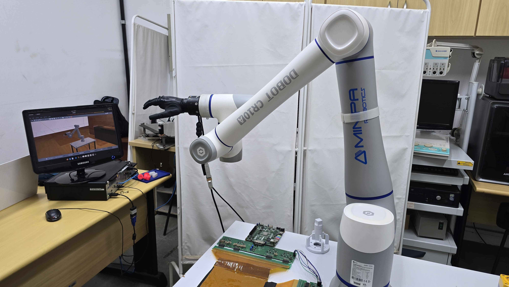
*Figura 1 — Bancada física com o CR10, a mão COVVI e o gêmeo no computador.*

## 1. Entenda as peças antes de começar

| Escolha | O que muda | Quando usar |
|---|---|---|
| `end_effector:=hand` | Modelo da mão COVVI; controles da mão e aba IMU | Manipular a mão, usar IMUs ou câmera |
| `end_effector:=touch_tool` | Ferramenta de palpação com célula FA7155 e ponteira F; aba Palpation | Palpação e medição de força |
| `sensor:=4` | Interpretar quadro do STM32 como matriz 4×4 | Firmware 4×4 instalado |
| `sensor:=5` | Interpretar quadro do STM32 como matriz 5×5 | Firmware 5×5 instalado |
| `control_mode:=sim_only` | Comandos ficam na simulação | Primeiro teste, sem mover o braço real |
| `control_mode:=mirror` | Permite comunicação e espelhamento com CR10 real | Bancada configurada e supervisionada |
| `force_source:=sim` | Força vem da simulação Gazebo | Teste sem célula física |
| `force_source:=real` | Força vem da FA7155 física | Montagem e comunicação da célula verificadas |

O padrão do launch é **hand**, sensor **5×5**, `sim_only` e fonte de força **real**. A escolha da fonte de força é independente do modo do braço: para uma simulação de palpação sem célula, informe `force_source:=sim` explicitamente. Uma matriz tátil é escolhida por vez; selecionar 4 ou 5 não grava firmware no STM32.

**Montagem atual:** a ponteira F da `touch_tool` possui célula de força, mas não acomoda o laminado tátil 5×5. Selecionar `sensor:=5` não instala fisicamente uma matriz nela. A célula FA7155 mede força/torque em seis eixos; ela e o sensor tátil STM32 são dispositivos diferentes.

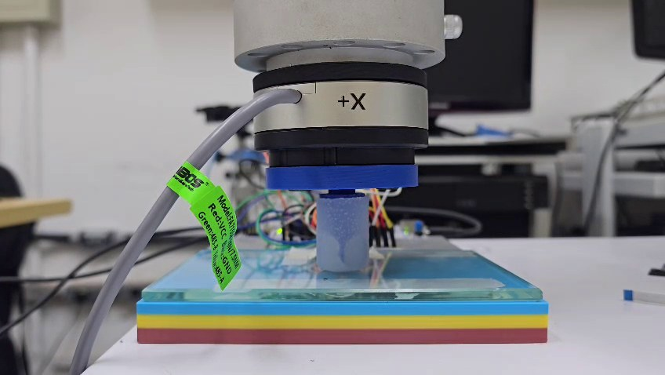
*Figura 2 — Ferramenta física de palpação. Confira a ponteira efetivamente montada antes de interpretar dados táteis.*

### Cuidados para a bancada

Comece em simulação, com a área de trabalho livre, parada de emergência acessível e movimento supervisionado. Confira ferramenta, carga útil, centro de massa, TCP, orientação e sentido da força antes de habilitar o braço real. O botão de emergência físico e os procedimentos da bancada continuam necessários. Não solte freios sem sustentar o braço: ele pode cair. A interface não substitui as proteções do fabricante.

## 2. Preparar um terminal

Depois da instalação da seção 12, abra um terminal e execute **em cada terminal novo**:

```bash
cd ~/cr10twin
source /opt/ros/humble/setup.bash
source install/setup.bash
```

Se o repositório estiver em outra pasta, troque `~/cr10twin` pelo caminho correto. Para encerrar um launch em primeiro plano use `Ctrl+C` no terminal em que ele foi iniciado; aguarde os processos terminarem antes de reiniciar.

## 3. Primeira execução: mão ou ferramenta

### 3.1 Mão COVVI em simulação

```bash
ros2 launch touch_pack tactile_cell.launch.py \
  end_effector:=hand sensor:=5 control_mode:=sim_only imu:=false
```

Espere o Gazebo carregar e a GUI abrir. Em **Manual Control**, mova devagar um controle da mão e observe a mão simulada. `imu:=false` evita procurar o software externo das IMUs neste primeiro teste. Troque `sensor:=5` por `sensor:=4` para a matriz 4×4 correspondente.

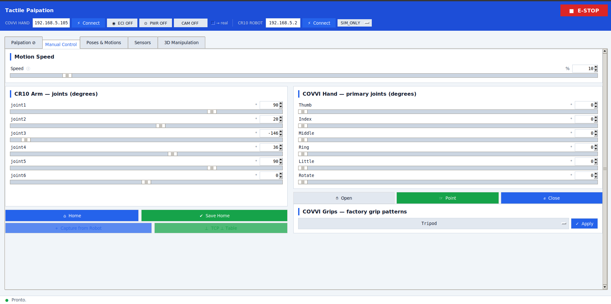
*Figura 3 — Exemplo real de Manual Control em modo mão; os controles podem mudar conforme a versão.*

### 3.2 TouchTool em simulação

```bash
ros2 launch touch_pack tactile_cell.launch.py \
  end_effector:=touch_tool sensor:=5 \
  control_mode:=sim_only force_source:=sim
```

A cena abre com a ferramenta e a GUI apresenta **Palpation** e **Load Cell**. Na simulação, a indicação da célula deve informar que a fonte é simulada. Se a GUI ou o Gazebo não abrir, confira as mensagens no terminal antes de repetir o comando.

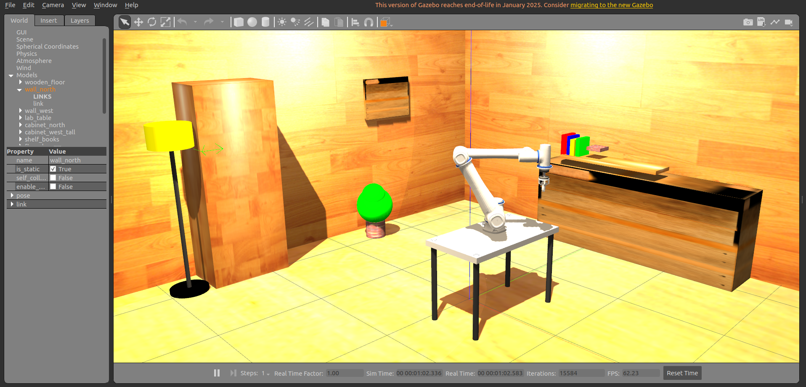
*Figura 4 — Célula simulada com ferramenta de palpação.*

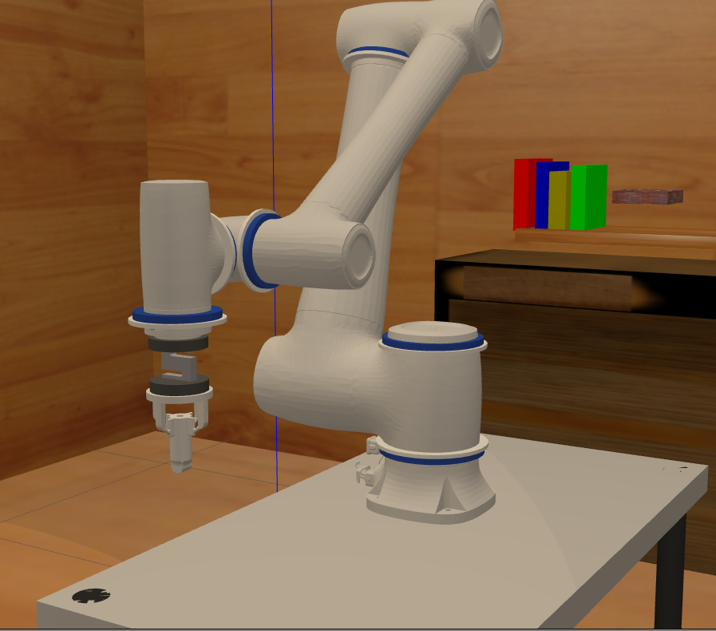
*Figura 5 — Detalhe da ferramenta no modelo simulado.*

### 3.3 Braço físico

Exemplo: substitua o IP pelo endereço verdadeiro do controlador; os valores de carga e centro de massa devem ser medidos para a sua ferramenta.

```bash
ros2 launch touch_pack tactile_cell.launch.py \
  end_effector:=touch_tool sensor:=5 \
  control_mode:=mirror force_source:=real robot_ip:=192.168.5.2 \
  payload_kg:=0.5 payload_cog_z_mm:=50.0
```

Os números de carga acima são os padrões da mão, **não valores validados para a sua TouchTool**. Na barra superior confirme IP, conexão, modo e estado antes de enviar qualquer comando. `mirror` pode enviar movimento ao braço; siga o fluxo da bancada e confirme a pose inicial. Para a mão use `end_effector:=hand`, verifique o IP da mão e conecte pela barra superior. `real_from_sim` é outra opção do launch para operação real; não a interprete como modo puramente simulado.

## 4. Sensores táteis 4×4 e 5×5

### 4.1 Identificar e conectar

1. Conecte ao USB o STM32 com o firmware correspondente à matriz física.
2. Identifique o dispositivo antes e depois de conectar:

   ```bash
   ls -l /dev/serial/by-id/ 2>/dev/null
   ls -l /dev/ttyACM* /dev/ttyUSB* 2>/dev/null
   ```

3. Inicie o launch com `sensor:=4` ou `sensor:=5`. A GUI procura a porta serial a 115200 baud, preferindo a USB CDC nativa do STM32 (`0483:5740`); nessa porta USB nativa o baud é ignorado. Abra **Sensors** e procure atualização do mapa e dos gráficos. Não mantenha outro programa conectado à mesma porta serial.
4. Pressione uma região conhecida e confira se a célula correspondente do mapa varia. Oriente a matriz e confira os eixos antes de registrar resultados.

Exemplos em simulação, trocando somente o sensor:

```bash
ros2 launch touch_pack tactile_cell.launch.py end_effector:=hand sensor:=4 imu:=false
ros2 launch touch_pack tactile_cell.launch.py end_effector:=hand sensor:=5 imu:=false
```

Execute **um comando por vez**. O firmware 4×4 fornece `I_final`/`TOTAL`; o 5×5 não envia a linha TOTAL e o sistema usa a média ADC como escalar. Portanto, os dois valores não são intercambiáveis como se fossem uma força calibrada. Os diretórios de firmware e ferramentas são `sensors/touch_4x4/` e `sensors/touch_5x5/`. Gravação do firmware exige a ferramenta STM32 e o procedimento específico da placa; o launch não faz essa gravação.

O mapa da tela é apresentado girado 180° em relação à numeração gravada nos CSVs nesta versão. Antes de comparar regiões da figura com colunas das planilhas, confirme a correspondência com um toque conhecido; não suponha que um canto da tela corresponda ao mesmo canto do arquivo.

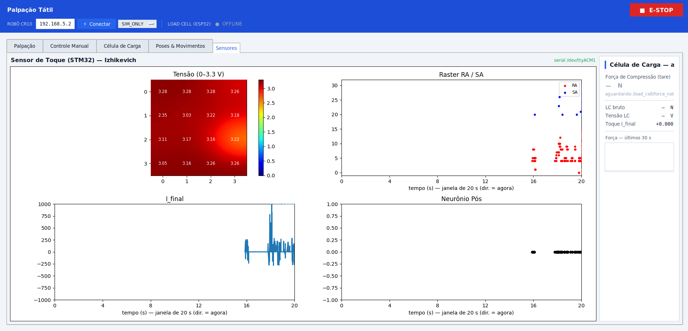
*Figura 6 — Exemplo da aba Sensors com matriz 4×4, raster e curvas. Para 5×5, a grade acompanha o sensor selecionado.*

### 4.2 Alternativa UDP

Sem serial local, há um caminho de retransmissão: o `touch_receiver` recebe o escalar pela porta UDP **8081**. Isso requer executar e configurar o retransmissor adequado em `sensors/touch_4x4/tools/` ou `sensors/touch_5x5/tools/`, com destino e rede corretos. A GUI atual não recebe os quadros completos por UDP 8082: para o mapa e os gráficos detalhados, conecte a serial USB do STM32 ao computador que executa a GUI. Não inicie um segundo leitor na mesma porta serial.

## 5. Célula de carga FA7155

O caminho atual usa a **FA7155**, conversor USB–RS485 e `ft_receiver`. O launch escolhe por padrão `ft_mode:=polled` e 1 Mbps para o exemplar da bancada. Há modelos/configurações diferentes: não altere baud, modo ou registradores sem conferir o equipamento. Algumas descrições antigas do README citam streaming a 115200; para a bancada atual prevalecem os padrões do launch e a configuração efetiva do sensor.

A documentação da montagem indica alimentação externa compatível com a célula (a bancada usa 24 V), terra comum com o conversor e conexões A/B. Confira o manual e a identificação física dos fios antes de energizar; a saída 5 V do conversor não alimenta a FA7155. Em **Load Cell**, verifique comunicação e seis eixos. Com a ponta livre, use **Tare all axes**; depois pressione levemente e confirme que a compressão aparece com o sinal esperado. O ajuste de eixo/sinal deve ser validado na bancada antes de um ensaio.

```bash
# Se a detecção automática escolher o adaptador errado, use o caminho correto:
ros2 launch touch_pack tactile_cell.launch.py \
  end_effector:=touch_tool force_source:=real ft_port:=/dev/ttyUSB0
```

`/dev/ttyUSB0` é apenas exemplo. A porta de `ft_receiver` não deve ser aberta simultaneamente por outro programa. A tara no host não é calibração de fábrica nem substitui a verificação de força e sinal. Sem dados válidos, não inicie palpação real.

## 6. IMUs em modo mão

A aba **IMU** aparece com `end_effector:=hand`. O launch inicia `imu_node` por padrão com `imu:=true`, mas as IMUs WBAN-Inercial também precisam do software externo **KINESIS**, dos ESPs configurados e da rede apropriada. Esse software não acompanha este repositório; use uma cópia existente autorizada. O caminho padrão esperado é:

```text
~/WBAN-Inercial/Software main/Sensores Inerciais Nova Interface
```

Essa pasta precisa conter `core/`. O nó também importa PyQt6 e `ahrs` no Python do ROS; a sugestão do próprio código para instalá-los está abaixo. Eles e as dependências do checkout externo devem ser validados no computador de destino:

```bash
python3 -m pip install --user 'PyQt6==6.10.2' 'ahrs==0.3.1' 'numpy<2'
```

Para usar outro caminho, passe-o entre aspas. Descubra o **IP local do computador** na interface que alcança os ESPs com `ip -br address`; ele não é o IP do CR10 nem o IP de um sensor. A configuração de Wi-Fi e do firmware dos ESPs pertence ao projeto externo e não é detalhada aqui.

```bash
ros2 launch touch_pack tactile_cell.launch.py \
  end_effector:=hand imu:=true imu_iface:=192.168.5.100 \
  "wban_dir:=$HOME/WBAN-Inercial/Software main/Sensores Inerciais Nova Interface"
```

Troque IP e caminho pelos reais. Na aba IMU observe os indicadores por sensor e aguarde dados; em outro terminal com o ambiente carregado, verifique:

```bash
ros2 topic list | grep /imu/
ros2 topic echo /imu/sensor_1 --once --qos-reliability best_effort
```

Troque `1` por um ID presente. Configure os IDs e comprimentos dos segmentos conforme a montagem, calibre e use **Zero** na postura de referência. **Start tracking** inicia o acompanhamento; teste primeiro em simulação. A opção **→ real CR10**, junto ao modo real apropriado, permite enviar movimento ao robô: só a habilite após validação e supervisão. Dados antigos congelam o acompanhamento; ausência de movimento pode significar perda de comunicação, não estabilidade.

### Calibração e opções

- **Acc + Gyro:** mantenha o sensor imóvel e apoiado em uma superfície plana durante a rotina indicada (aproximadamente 10 s).
- **Magnetometer:** execute a rotina de aproximadamente 30 s, girando lentamente o sensor em diferentes orientações, um por vez, longe de objetos metálicos. Verifique qualidade e instruções exibidas.
- **Zero** redefine a referência; **Home** encerra o tracking e retorna à função de home. **Stop tracking** interrompe o acompanhamento.
- Configure orientação, segmentos, eixos, escala, heading e bloqueio de juntas conforme a anatomia/montagem. O acompanhamento baseado em aceleração pode acumular deriva e pede uma fase inicial imóvel. Os controles de gravação registram os dados da sessão.

## 7. Câmera para movimentar a mão

A função **CAM** usa a webcam para estimar flexão dos dedos e comandar a mão simulada. Está disponível em modo `hand`; precisa de OpenCV e de uma versão compatível da API **MediaPipe Hands**. É um recurso opcional, com dependências e validação próprias na seção 12. A câmera padrão é índice 0.

1. Conecte a webcam, libere acesso a `/dev/video0` e feche outros programas que a estejam usando.
2. Inicie `end_effector:=hand control_mode:=sim_only imu:=false` e selecione **CAM OFF** para ativar; observe a janela de pré-visualização.
3. Em boa iluminação, mostre uma mão e flexione os dedos. Compare os movimentos com a mão simulada; a câmera também pode movimentar a junta 6 simulada do braço. Se não houver reconhecimento, confira câmera, permissões, dependências e mensagens no terminal.
4. Desative novamente no botão CAM ou feche a pré-visualização. Antes de comandar a mão física, confira os controles **→ real**, conexão COVVI e **ECI ON**; o movimento real do CR10 exige também a configuração correspondente de espelhamento. Teste com espaço livre e supervisão.

O rastreamento depende de iluminação, posição, calibração e versão das bibliotecas; não trate uma estimativa visual como medição clínica ou comando seguro por si só.

## 8. Referência da interface gráfica

### 8.1 Barra superior

- **E-STOP:** parada de emergência disponibilizada pela interface; mantenha também acesso à parada física.
- **CR10 ROBOT:** IP do controlador, conexão e seleção/indicação de modo simulado ou espelhado.
- **COVVI HAND** em modo mão: IP, **Connect**, **ECI**, **PWR**, **CAM** e a opção **→ real**. A conexão e o acionamento da mão dependem do driver e do hardware, não apenas de abrir o Gazebo.
- **LOAD CELL** em modo ferramenta: mostra o estado da fonte de força.

### 8.2 Palpation — ferramenta de palpação

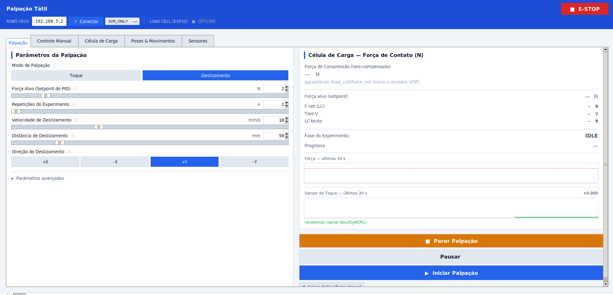
*Figura 7 — Exemplo da aba Palpation no modo Slide.*

Selecione **Palpation Mode**:

| Modo | Ciclo e exemplo de uso |
|---|---|
| **Touch** | Aproxima, atinge a força, mantém e retrai. Exemplo: testar três toques em uma amostra simulada. |
| **Slide** | Acrescenta deslocamento lateral; escolha distância, velocidade e direção `±X`/`±Y`. |
| **Manual** | Mantém contato com alvo ajustável até intervenção do operador. |
| **Matrix** | Mede uma grade; descobre a origem por contato e desloca-se em altura segura entre pontos. |

**Target Force** define a força alvo de compressão, em N; **repetições** define quantos ciclos quando aplicável. A profundidade máxima de descida é limite de percurso, não uma ordem para descer essa distância. **Start**, **Stop** e **Pause** iniciam, interrompem ou pausam; observe fase, força e gráficos antes de prosseguir. Habilite **Record data** para salvar a execução.

Em **Touch**, **Modulated Force** permite `Off`, `Sine` ou `Cosine`, mínimo, máximo, frequência e ciclos. Frequências altas podem gerar forma de onda grosseira ou amplitude menor que a pedida; a frequência registrada pode não reproduzir fielmente a comandada. Para matriz, defina formato/plano, origem, ordem de visita, dimensões ou passos, linhas/colunas, **Safe Z** e velocidade de trânsito; confira o preview antes de iniciar. A opção de níveis em escada usa passo, primeiro nível, pico e tempo por nível quando disponível.

Em **Advanced**, ajuste limite e velocidade de descida, tolerância e janela de estabilidade do HOLD, timeout e parâmetros de aproximação. **Home conhecida** indica contato aprendido para a home atual; não reutilize uma referência antiga após mover a amostra ou ferramenta. A sondagem de superfície/ângulo permite definir pontos, raio, força, retração e inclinação máxima; o ajuste manual usa inclinação, azimute, força e folga. Esses controles exigem verificar geometria, direção e forças reais antes do uso.

**Exemplo seguro de exploração da tela:** em `sim_only force_source:=sim`, escolha `Touch`, três repetições e uma força baixa apropriada à cena; confira home, limites e espaço, inicie e observe as fases até o retorno. Ajuste ao comportamento real da simulação. Valores de exemplo não são prescrição para uma amostra física.

### 8.3 Manual Control

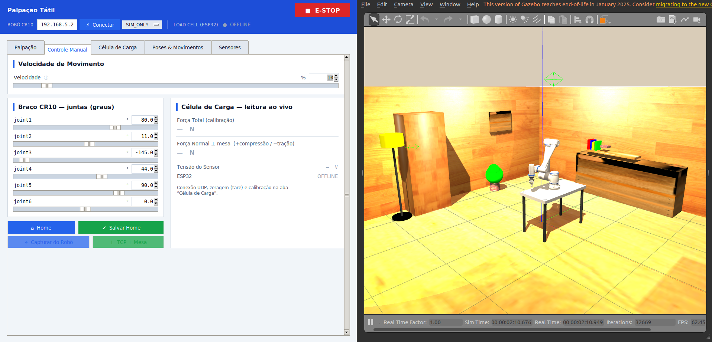
*Figura 8 — Controles articulares e Gazebo lado a lado.*

Os seis controles CR10 comandam juntas. **Speed %** e duração ajustam a movimentação; **Home** e **Save Home** usam/gravam uma posição inicial. **Capture from Robot** usa a posição física quando disponível; **TCP ⊥ Table** auxilia na orientação. Em modo mão aparecem os controles dos dedos, presets **Open**, **Point**, **Close**, e **COVVI Grips / Apply**. Comece com passos pequenos.

O **Cartesian jog** move `X/Y/Z ±` em passos de 0,1, 1 ou 10 mm no referencial **Base** ou **Tool**. A mesma seta pode apontar em direções físicas diferentes conforme o referencial e a orientação da ferramenta. Em `mirror`, comandos podem chegar ao braço real. O painel também pode apresentar leitura da célula e mapa tátil.

**TCP calibration** usa quatro capturas tocando o mesmo ponto físico em quatro orientações diferentes. Uma solução inválida é recusada; reinicie a GUI após salvar para aplicar. Refaça a verificação após mudar a ferramenta. Os **Joint brakes** só devem ser operados com o braço desabilitado e sustentado; soltar o freio pode causar queda.

### 8.4 Load Cell

Em modo TouchTool, **6 Axes** mostra `Fx/Fy/Fz` em N e `Mx/My/Mz` em N·m, estado da comunicação e taxa. **Tare all axes** zera o referencial no host. Há seleção de aquisição **polled/stream**, gráficos, escalas/congelamento, filtro de visualização, estatísticas, reset e gravação CSV. Os painéis de comandos Modbus, busca e configuração afetam a comunicação: use-os somente conforme o manual da célula e a configuração da bancada. Filtro visual não substitui validação da cadeia de controle.

### 8.5 Poses & Motions

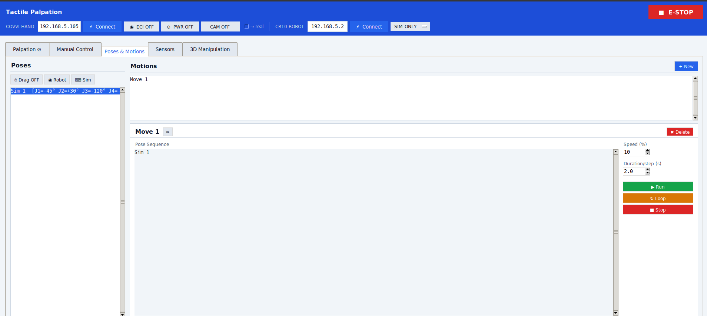
*Figura 9 — Captura de poses e montagem de uma sequência.*

Capture pose de **Robot** ou **Sim**, nomeie, renomeie ou exclua. Em **Motions**, crie uma sequência, escolha poses, velocidade e duração; use **Run**, **Loop** ou **Stop**. **Drag Teach** libera o braço para ensino manual quando a configuração real permite; use as instruções do controlador e mantenha o braço sustentado. A gravação converte o percurso em pontos intermediários: a reprodução interpola entre eles e não garante repetir exatamente a curva desenhada. Poses e movimentos ficam em `~/.config/touch_pack/poses.json`.

### 8.6 Sensors

Mostra matriz, gráficos do modelo Izhikevich, raster RA/SA, corrente/atividade e leitura de força conforme dados disponíveis. **Detach** abre a aba em janela separada; **Attach** ou fechar a janela a devolve à GUI. Uma tela aberta sem variação não garante que o dispositivo esteja conectado; confira a fonte e os dados.

### 8.7 3D Manipulation

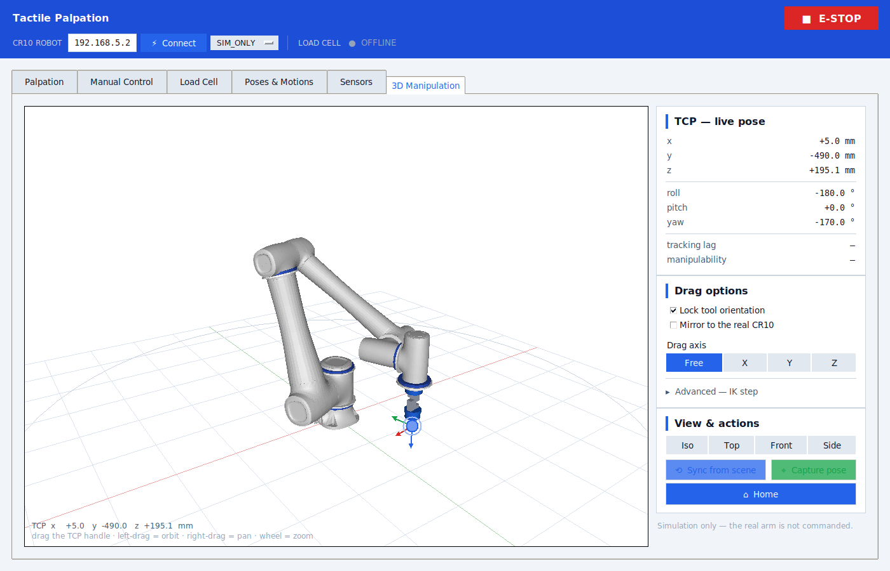
*Figura 10 — Manipulação 3D com a ferramenta.*

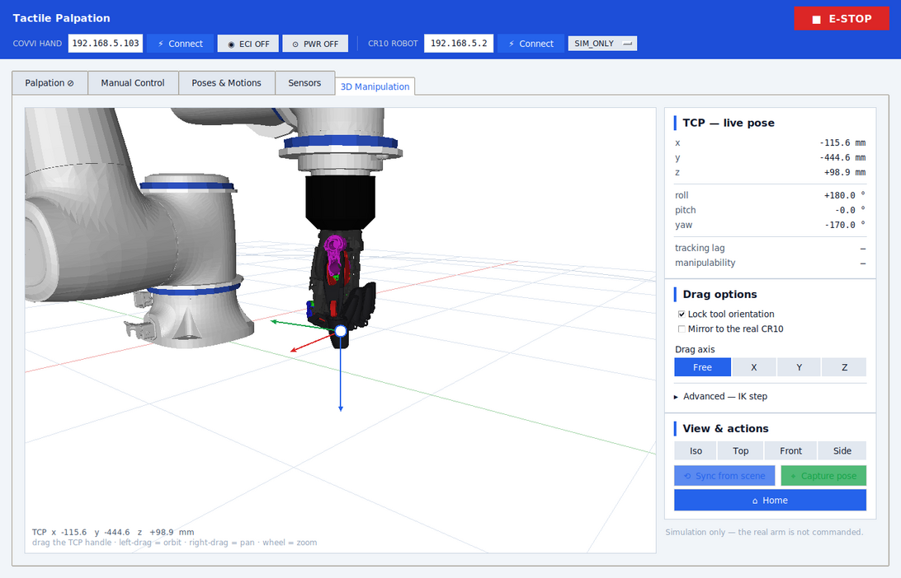
*Figura 11 — Mesma visualização com a mão COVVI.*

Arraste o marcador no TCP para mudar a posição; arrastar fora dele orbita a câmera. A interface mostra pose, opções de eixo livre/X/Y/Z, limites de passo, visões e sincronização/captura da cena. Selecione o eixo para restringir o movimento e confira o resultado no simulador. A opção de espelhamento para o CR10 real deve permanecer desligada durante a familiarização; quando habilitada no modo compatível, o resultado do arraste pode mover o hardware. A visualização pode usar VTK ou uma alternativa de CPU.

### 8.8 IMU

Em modo mão, a primeira aba é **IMU** em lugar de Palpation. Consulte a seção 6 para conexão, calibração, indicadores, tracking, referência, gravação e autorização explícita de movimento real.

## 9. Roteiros rápidos

### A. Ver a mão simulada com sensor 4×4

1. Conecte o STM32 com firmware 4×4, ou prossiga sem ele apenas para testar a mão.
2. Prepare o terminal pela seção 2 e execute:

   ```bash
   ros2 launch touch_pack tactile_cell.launch.py end_effector:=hand sensor:=4 imu:=false
   ```

3. Use **Manual Control** para observar os dedos; em **Sensors**, verifique se a grade recebe dados. Encerre com `Ctrl+C`.

### B. Testar a ferramenta simulada com matriz 5×5 separada

1. Conecte o STM32 5×5. Lembre que a ponteira F atual não o incorpora.
2. Inicie `end_effector:=touch_tool sensor:=5 control_mode:=sim_only force_source:=sim` conforme seção 3.2.
3. Confira a força simulada e a matriz real em suas respectivas abas; são fontes distintas. Faça um teste Touch apenas após conferir a cena.

### C. Mão com IMU ou câmera

Para IMU siga a seção 6, incluindo KINESIS e IP local. Para webcam use a seção 7 e `imu:=false` se não estiver usando IMUs. Ambos começam com `end_effector:=hand`.

## 10. Onde ficam os dados

Registros de palpação são criados em `sensors/Data/` do repositório, quando a gravação está ativa. A execução pode gerar CSVs e resumos JSON; o mapeamento matricial gera arquivo `__matrix.csv`. Confira o caminho informado no terminal/GUI e abra os arquivos após finalizar. Arquivos de configuração ficam em `~/.config/touch_pack/`, incluindo `poses.json`, homes e `tcp_calib.json`. Faça cópia desses dados antes de trocar de máquina ou redefinir configurações.

## 11. Diagnóstico rápido

| Sintoma | O que verificar |
|---|---|
| `ros2: command not found` | ROS instalado e `source /opt/ros/humble/setup.bash` no terminal atual. |
| Pacote/launch não encontrado | `cd` no repositório, build concluído e `source install/setup.bash`. |
| Gazebo ou janela não abre | Terminal com ambiente gráfico ativo, mensagens de erro, suporte gráfico e dependências; não use SSH sem configurar tela. |
| Matriz parada | Firmware 4/5, baud, cabo de dados, porta/permissão e outro programa usando a serial; confira seleção `sensor:=`. |
| Célula sem leitura | Alimentação, RS485, terra comum, porta, modo/baud e estado em Load Cell. Não rode dois leitores da mesma porta. |
| Não inicia palpação | Use `touch_tool`; verifique fonte de força, dados válidos, configuração e mensagens de estado. |
| Sem IMU | Confira `core/` do KINESIS, IP **local**, rede dos ESPs, IDs e tópicos. |
| Câmera não abre | `/dev/video*`, permissão, outros aplicativos, OpenCV/MediaPipe e índice. |
| Mão ou braço real não responde | IPs e rede, estado da conexão, modo, habilitação e controlador; não tente corrigir enviando movimentos repetidos. |

## 12. Instalação do zero — Ubuntu 22.04

### 12.1 Antes de instalar

Instale Ubuntu **22.04 LTS Desktop**, conecte à internet, entre em uma conta com permissão `sudo` e abra Terminal com `Ctrl+Alt+T`. O comando abaixo deve mostrar `22.04` e `jammy`:

```bash
cat /etc/os-release
```

Você precisará de internet e espaço para pacotes ROS, Gazebo e compilação. Atualizações de sistema podem pedir reinicialização. ROS 2 Humble e Gazebo Classic são a base deste projeto; siga o procedimento institucional de manutenção do computador.

### 12.2 Opção automática

O instalador independente instala o Git, pergunta se você quer configurar nome e e-mail para commits e oferece autenticação no GitHub pelo navegador usando o GitHub CLI. As duas configurações são opcionais: baixar este repositório público não requer conta nem senha. Se aceitar a autenticação, siga as instruções do `gh`; não informe sua senha ou token ao script. Os dados globais de nome e e-mail só mudam se você confirmar e preencher ambos. Sem terminal interativo, o script mantém essas configurações como estão.

**Enquanto o instalador não estiver publicado no repositório remoto:** copie o arquivo `tools/install_touch_pack_ubuntu2204.sh` entregue junto com este tutorial para o computador Ubuntu e execute `bash` seguido do caminho do arquivo. Depois de publicado na branch `main`, a forma habitual será clonar o projeto e executar o script do próprio clone:

```bash
sudo apt update
sudo apt install -y git ca-certificates
git clone --recursive https://github.com/Martins-Lucaas/cr10twin.git ~/cr10twin
cd ~/cr10twin
bash tools/install_touch_pack_ubuntu2204.sh
```

Se `~/cr10twin` já for um clone deste projeto, não clone por cima: entre nele e execute o script. Como alternativa, depois da publicação, também é possível baixar o instalador independente antes do clone:

```bash
sudo apt update
sudo apt install -y curl ca-certificates
curl -fL -o install_touch_pack_ubuntu2204.sh \
  https://raw.githubusercontent.com/Martins-Lucaas/cr10twin/main/tools/install_touch_pack_ubuntu2204.sh
less install_touch_pack_ubuntu2204.sh
bash install_touch_pack_ubuntu2204.sh
```

Pressione `q` para sair de `less`. O script solicita `sudo`, atualiza os índices do APT, instala as dependências necessárias e compila. Se o clone não existir, ele cria `~/cr10twin` com os submódulos. Se já existir, só usa um clone com `origin` correspondente e não faz `git pull` no repositório principal; outro conteúdo provoca interrupção. Adiciona o usuário ao grupo `dialout`: saia e entre novamente para a permissão funcionar.

**Se algo já estiver instalado:** o APT normalmente reaproveita os pacotes que satisfazem as dependências; o instalador não executa mais `apt upgrade` geral. Entretanto, APT e `rosdep` podem instalar ou atualizar pacotes necessários, e o build atualiza os artefatos do workspace. O script aproveita a configuração `rosdep` existente e verifica a versão de NumPy e `covvi-eci`: se encontrar NumPy incompatível ou uma versão diferente da COVVI exigida, interrompe e solicita a resolução do conflito, em vez de substituir silenciosamente a biblioteca Python. Se a COVVI estiver ausente, instala `covvi-eci==1.1.6` para o usuário. Câmera MediaPipe, KINESIS, rede, firmware e testes físicos são etapas separadas. Leia as mensagens e resolva erros antes de continuar.

Para evitar envio acidental, quando não há `pushurl` previamente configurado o script adiciona uma barreira local ao push via `origin`. Se já existir uma configuração de push, ele a preserva e avisa: **nesse caso não presume que o envio esteja bloqueado**. Veja o fluxo de fork e as limitações na seção 12.7. O script não foi executado em um Ubuntu limpo nesta sessão.

### 12.3 Opção comando a comando — sistema e ROS

```bash
sudo apt update
sudo apt install -y software-properties-common curl git ca-certificates
sudo add-apt-repository -y universe
sudo apt update
```

A documentação oficial recomenda atualizar o Ubuntu antes de instalar ROS. Se decidir executar `sudo apt upgrade`, saiba que isso pode atualizar outros pacotes do sistema; confira o que será alterado e reinicie se necessário.

Configure a origem oficial de pacotes ROS 2 pelo pacote `ros2-apt-source`:

```bash
ROS_APT_SOURCE_VERSION=$(curl -fsSL https://api.github.com/repos/ros-infrastructure/ros-apt-source/releases/latest | grep -F 'tag_name' | awk -F '"' '{print $4}')
test -n "$ROS_APT_SOURCE_VERSION"
curl -fL -o /tmp/ros2-apt-source.deb "https://github.com/ros-infrastructure/ros-apt-source/releases/download/${ROS_APT_SOURCE_VERSION}/ros2-apt-source_${ROS_APT_SOURCE_VERSION}.jammy_all.deb"
sudo dpkg -i /tmp/ros2-apt-source.deb
sudo apt update
sudo apt install -y ros-humble-desktop ros-dev-tools
source /opt/ros/humble/setup.bash
```

Execute os comandos em ordem; pare se algum falhar. A documentação ROS recomenda atualizar o sistema antes de instalar Humble. A referência oficial atual está nas [instruções de repositório ROS 2](https://github.com/ros2/ros2_documentation/blob/humble/source/Installation/_Apt-Repositories.rst) e na [instalação Ubuntu de Humble](https://github.com/ros2/ros2_documentation/blob/humble/source/Installation/Ubuntu-Install-Debs.rst).

### 12.4 Clonar e instalar dependências do projeto

Se quiser identificar seus commits, configure o nome e o e-mail desejados; eles ficam gravados globalmente e aparecem nos commits. São opcionais para clonar:

```bash
git config --global user.name 'Seu nome'
git config --global user.email 'voce@exemplo.com'
```

Para autenticar no GitHub opcionalmente, instale o cliente e siga a autenticação pelo navegador:

```bash
sudo apt install -y gh
gh auth login --hostname github.com --git-protocol https --web
```

GitHub pode solicitar autorização no navegador. Login não é necessário para copiar o repositório público, e autorização para enviar alterações depende das permissões da sua conta.

```bash
git clone --recursive https://github.com/Martins-Lucaas/cr10twin.git ~/cr10twin
cd ~/cr10twin
```

Para adicionar no clone novo a mesma barreira local de push usada pelo script, primeiro consulte todos os destinos configurados:

```bash
git config --get-all remote.origin.pushurl
```

Se o comando não mostrar nenhum valor, execute `git remote set-url --push origin no_push://disabled`. Se já mostrar valores, preserve-os e avalie-os antes de mudar a configuração. Confira com `git remote -v`; o endereço de **fetch** continua apontando para o projeto e permite `pull`. A seção 12.7 explica como enviar alterações para o fork e esclarece os limites dessa barreira.

Se já possui uma cópia, use sua pasta e execute `git submodule update --init --recursive` somente depois de verificar e preservar alterações nos submódulos. O submódulo `src/eci_ros` fornece interfaces necessárias também para o build de simulação. Instale as dependências e inicialize o catálogo `rosdep` se necessário:

```bash
sudo apt install -y python3-rosdep python3-colcon-common-extensions \
  python3-pip python3-tk python3-pil python3-numpy python3-matplotlib \
  python3-serial python3-opencv python3-vtk9 \
  ros-humble-gazebo-ros-pkgs ros-humble-ros2-control \
  ros-humble-ros2-controllers ros-humble-gazebo-ros2-control \
  ros-humble-xacro ros-humble-joint-state-publisher-gui \
  ros-humble-vision-msgs ros-humble-cv-bridge ros-humble-control-msgs \
  ros-humble-admittance-controller ros-humble-kinematics-interface-kdl \
  ros-humble-force-torque-sensor-broadcaster
```

```bash
# Execute init somente se a configuração ainda não existir:
test -f /etc/ros/rosdep/sources.list.d/20-default.list || sudo rosdep init
rosdep update
rosdep install --from-paths src --ignore-src -r -y
```

O NumPy precisa permanecer na série **1.x** para a ABI do `cv_bridge` do Humble. Confira também se a versão Python da COVVI já existe antes de instalar:

```bash
python3 -c "import numpy; print('NumPy:', numpy.__version__)"
python3 -m pip show covvi-eci
```

Se o segundo comando informar que o pacote não foi encontrado, instale `python3 -m pip install --user 'covvi-eci==1.1.6'`. Se já houver `1.1.6`, mantenha-a. Se houver outra versão, avalie o conflito antes de trocar: o driver declara exatamente `1.1.6`. Não continue com NumPy 2.x; resolva o ambiente Python primeiro. Verifique a disponibilidade e licença da biblioteca COVVI. Então compile:

```bash
colcon build --symlink-install
source install/setup.bash
```

Se algum pacote ou resolução de dependência falhar, não ignore o erro: confira o terminal e a documentação atual. Não apague diretórios de build ou dados sem primeiro verificar seu conteúdo.

### 12.5 Porta serial e câmera

O grupo `dialout` normalmente permite acesso às portas seriais; entre novamente na sessão gráfica após o comando:

```bash
sudo usermod -aG dialout "$USER"
groups
```

Para webcam, confira também `ls -l /dev/video*` e as permissões existentes. A GUI de câmera usa `mp.solutions.hands`, e as versões recentes do MediaPipe podem ter API diferente. O próprio projeto alerta que MediaPipe pode conflitar com OpenCV/protobuf do ROS. Uma tentativa para Ubuntu 22.04 x86-64 e Python 3.10, ainda não testada nesta sessão, é instalar a versão anterior à remoção da API e manter NumPy 1.x:

```bash
python3 -m pip install --user 'numpy<2' 'opencv-contrib-python<4.12' 'mediapipe==0.10.21'
```

Essa instalação altera pacotes Python do usuário: confira conflitos se o computador tiver outros projetos. Valide os imports abaixo no **mesmo Python** que inicia a GUI:

```bash
python3 -c "import cv2, mediapipe as mp; print('OpenCV:', cv2.__version__, 'MediaPipe:', mp.__version__); print('Hands:', mp.solutions.hands.Hands)"
```

O projeto sugere `mediapipe>=0.10,<0.11`, mas essa faixa inclui versões sem `mp.solutions` e não garante ausência de conflitos. A [publicação 0.10.21 no PyPI](https://pypi.org/project/mediapipe/0.10.21/) lista Python 3.10; a [documentação de Hands](https://github.com/google-ai-edge/mediapipe/blob/master/docs/solutions/hands.md) descreve a API usada. Se o teste falhar, identifique o conflito antes de usar CAM; a instalação base funciona sem essa opção. KINESIS é externo e precisa ser obtido separadamente.

### 12.6 Verificar a instalação

```bash
cd ~/cr10twin
source /opt/ros/humble/setup.bash
source install/setup.bash
ros2 pkg prefix touch_pack
ros2 launch touch_pack tactile_cell.launch.py --show-args
ros2 launch touch_pack tactile_cell.launch.py \
  end_effector:=touch_tool control_mode:=sim_only force_source:=sim
```

Confirme GUI e Gazebo, veja a ferramenta e use `Ctrl+C` para encerrar. Depois teste cada dispositivo individualmente. Se quiser manter o ambiente automático, acrescente os dois comandos `source` ao seu `~/.bashrc` somente depois de entender que serão executados em **todo** terminal; se outro workspace ROS for usado, prefira carregá-los manualmente.

### 12.7 Atualizar o repositório e contribuir por pull request

O repositório público original é usado para **clone e pull**. Para propor uma alteração, crie um **fork** na sua conta ou em uma organização, envie uma branch apenas para esse fork e abra um pull request para `Martins-Lucaas/cr10twin`. O proprietário não consegue criar um fork pessoal do próprio repositório na mesma conta: use outra conta/organização autorizada para esse fluxo. Uma pessoa precisa revisar e aceitar o pull request no GitHub para fazer o merge.

Para atualizar uma cópia já clonada, primeiro confira e preserve suas alterações locais. Só troque de branch quando a árvore estiver limpa ou suas alterações estiverem salvas:

```bash
cd ~/cr10twin
git status
git switch main
git pull --ff-only origin main
git submodule update --init --recursive
```

Se `git pull --ff-only` recusar porque as branches divergiram, não force a atualização: examine a situação antes de prosseguir. Uma atualização de submódulo também pode falhar caso existam alterações locais nele; preserve-as primeiro.

Para contribuir pela primeira vez:

1. Entre no GitHub, acesse [cr10twin](https://github.com/Martins-Lucaas/cr10twin) e use **Fork** para criar sua cópia pessoal ou da organização. Autentique o GitHub CLI pela seção 12.4 se for enviar via HTTPS.
2. No terminal, substitua `SEU_USUARIO` pelo dono do fork e registre-o com o nome `fork`:

   ```bash
   cd ~/cr10twin
   git remote add fork https://github.com/SEU_USUARIO/cr10twin.git
   git remote -v
   ```

3. Partindo da `main` atualizada e sem alterações pendentes, crie sua branch, altere os arquivos e confira o resultado:

   ```bash
   git switch -c minha-alteracao
   git status
   git add caminho/do/arquivo
   git commit -m 'Descreve a alteração'
   git push -u fork minha-alteracao
   ```

   Substitua `caminho/do/arquivo` pelo arquivo alterado. O push é feito **somente para o fork**, nunca para `origin` do projeto principal.
4. No GitHub, abra um pull request com **base** `Martins-Lucaas/cr10twin:main` e **origem** `SEU_USUARIO/cr10twin:minha-alteracao`. Descreva a mudança e os testes, aguarde revisão e siga as solicitações do mantenedor.

A configuração local de Git pode prevenir um `git push origin` acidental, mas não impede outro computador, um remote diferente ou uma URL explícita de enviar alterações. Para garantir revisão no servidor, o mantenedor deve configurar [proteção da branch no GitHub](https://docs.github.com/en/repositories/configuring-branches-and-merges-in-your-repository/managing-protected-branches/about-protected-branches), exigir pull request e verificar se administradores também estão sujeitos à regra. A proteção da `main` não bloqueia automaticamente outras branches.

## Fontes no projeto

- [README do touch_pack](../src/touch_pack/README.md), [README principal](../README.md) e [launch atual](../src/touch_pack/launch/tactile_cell.launch.py).
- [GUI principal](../src/touch_pack/touch_pack/palpation_gui.py), módulos `gui_*.py`, [nó IMU](../src/touch_pack/touch_pack/imu_node.py) e [câmera](../src/touch_pack/touch_pack/hand_camera_teleop.py).
- [Decisões de projeto](adr/) e manuais dos fabricantes disponíveis na bancada. Em caso de divergência, confirme a versão do código, a montagem e os manuais do equipamento.
