<div align="center">

# cr10twin
### Digital Twin · CR10 + COVVI Hand · Biomedical Manufacturing Cell

[](https://github.com/Martins-Lucaas/cr10twin/actions/workflows/ci.yml)
[](https://docs.ros.org/en/humble/)
[](http://classic.gazebosim.org/)
[](https://releases.ubuntu.com/22.04/)
[](https://www.python.org/)
[](LICENSE)

</div>

<p align="center">
  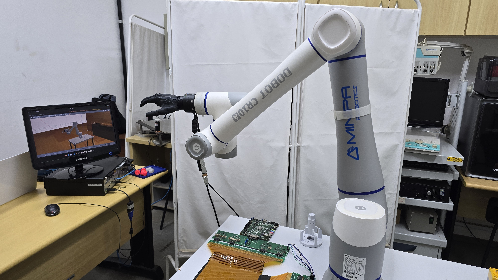
</p>
<p align="center"><em>The physical bench — <strong>Dobot CR10A</strong> with the <strong>COVVI Hand</strong> on the flange — next to the Gazebo digital twin running the same pose.</em></p>

Digital twin of the **Dobot CR10** industrial arm coupled to the **COVVI Hand** bionic prosthetic hand, running on **ROS 2 Humble / Gazebo Classic 11**. The system identifies pharmaceutical objects on a conveyor, classifies them by the grasp type they require and drops them into the correct bins — with a direct channel to the physical COVVI hand over the ECI Ethernet protocol.

Part of an **undergraduate thesis (TCC) in Biomedical Engineering** — a virtual platform to support the training of users of multi-DOF prosthetic hands. The same hardware (CR10 + COVVI) is reused in a second **tactile palpation** cell, which reproduces the protocol of Gupta et al. 2021 with force control and Cartesian sliding.

---

## Videos

Click a strip to open the video — GitHub plays it in the file viewer.

<p align="center">
  <a href="images/tcc_video_visao_geral.mp4">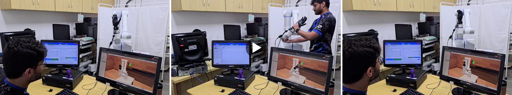</a>
</p>
<p align="center"><em><strong>Overview (52 s)</strong> — the bench end to end: GUI, real arm with the COVVI hand and the Gazebo twin following it.</em></p>

<p align="center">
  <a href="images/real_to_sim_drag_teach_bench.mp4">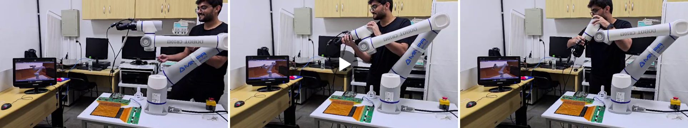</a>
</p>
<p align="center"><em><strong>Real-to-Sim drag teach (27 s)</strong> — the arm is moved by hand with the motors released; the twin on the left monitor mirrors it from the 125 Hz feedback.</em></p>

<p align="center">
  <a href="images/tcc_video_2026-07-06_10-53-14.mp4">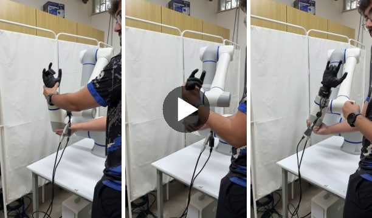</a>
  <a href="images/tcc_screencast_2026-07-06_10-30-20.webm">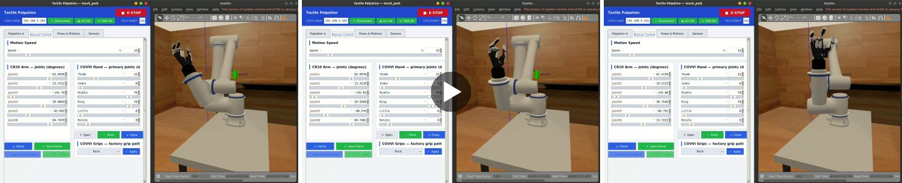</a>
</p>
<p align="center"><em><strong>Drag teach with the COVVI hand (20 s)</strong> · <strong>Manual Control → COVVI grips in Gazebo (51 s)</strong>.</em></p>

<p align="center">
  <a href="images/palpation_fa7155_touch_side_x.mp4">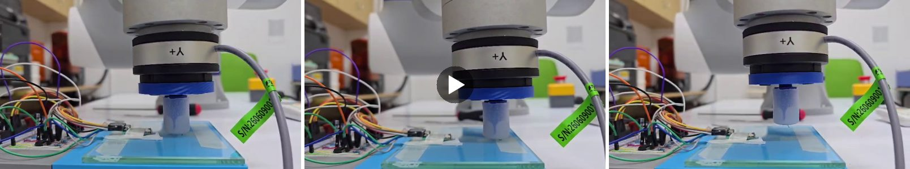</a>
  <a href="images/palpation_fa7155_touch_side_y.mp4">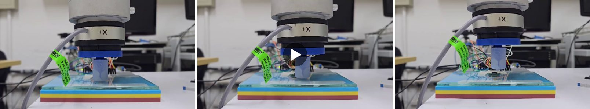</a>
</p>
<p align="center"><em><strong>The real CR10 with the FA7155 cell touching a sample</strong>, filmed from two sides of the sensor (9 s · 10 s).</em></p>

---

## The sim ↔ real bridge

<p align="center">
  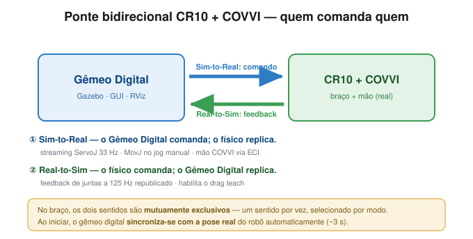
</p>
<p align="center"><em>One direction at a time, selected by mode: <strong>Sim-to-Real</strong> (the twin commands, the hardware replicates — ServoJ streaming at 33 Hz, MovJ on manual jog, COVVI hand over ECI) and <strong>Real-to-Sim</strong> (the hardware commands, the twin replicates — joint feedback at 125 Hz, which enables drag teach). Diagram labels are in Portuguese.</em></p>

<p align="center">
  
</p>
<p align="center"><em>At startup, <code>real_pose_sync</code> reads the real arm's pose and drives Gazebo to it (~3 s), so the twin is born synchronized rather than in an arbitrary URDF pose.</em></p>

<p align="center">
  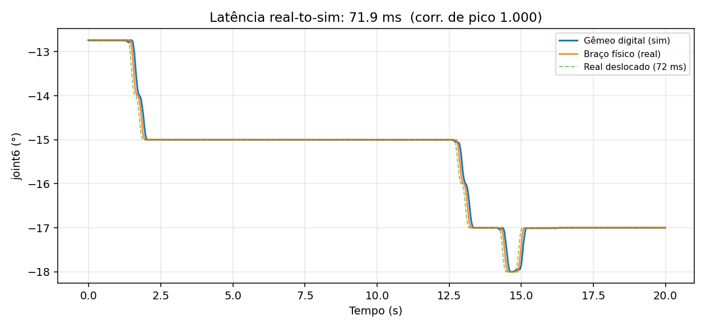
</p>
<p align="center"><em>Mirroring latency, measured by cross-correlating the simulated and physical joint series (<code>latency_probe</code> / <code>hand_latency_probe</code>). Real-to-Sim on 10/09/2026: <strong>arm ≈ 72 ms</strong> (median of 16 runs, 71–80 ms) and <strong>COVVI hand ≈ 135 ms</strong> (4 runs). Raw series and results in <code>data/latency/</code> and <code>data/latency_hand/</code>. Plot labels are in Portuguese.</em></p>

---

## Hardware

| Component | Model | Specifications |
|---|---|---|
| Arm | **Dobot CR10A** | 6-DOF, 1300 mm reach, 10 kg payload, ±0.03 mm repeatability, TCP/IP V4 protocol |
| Hand | **COVVI Hand** | 5 fingers + 31 joints (6 primary + 25 mimic), ECI Ethernet interface |
| Camera | Gazebo RGB | 848×480, 70° FoV, mounted behind the conveyor |
| Load cell | **FA7155 6-axis F/T cell** (on the bench since 07/09/2026) | RS485 → USB via a **CH343** converter (VID `0x1A86`), polled at 1 Mbps by `ft_receiver`. See `docs/adr/0002` |
| Touch sensor | STM32 + taxel array — **4×4 or 5×5**, selected with `sensor:=4\|5` (default `5`) | USB-CDC at 115200 baud; Izhikevich neuromorphic model (RA/SA spikes + `I_final`). Optional UDP relay: **8081** (scalar) · **8082** (raw frame) |
| IMUs | **WBAN-Inercial** — 6 ESPs over Wi-Fi | `imu_node` publishes `/imu/sensor_<id>` (Madgwick orientation); hand mode only (`imu:=true`). `tools/imu_arm_teleop` uses them to teleoperate the CR10 by arm motion |

<p align="center">
  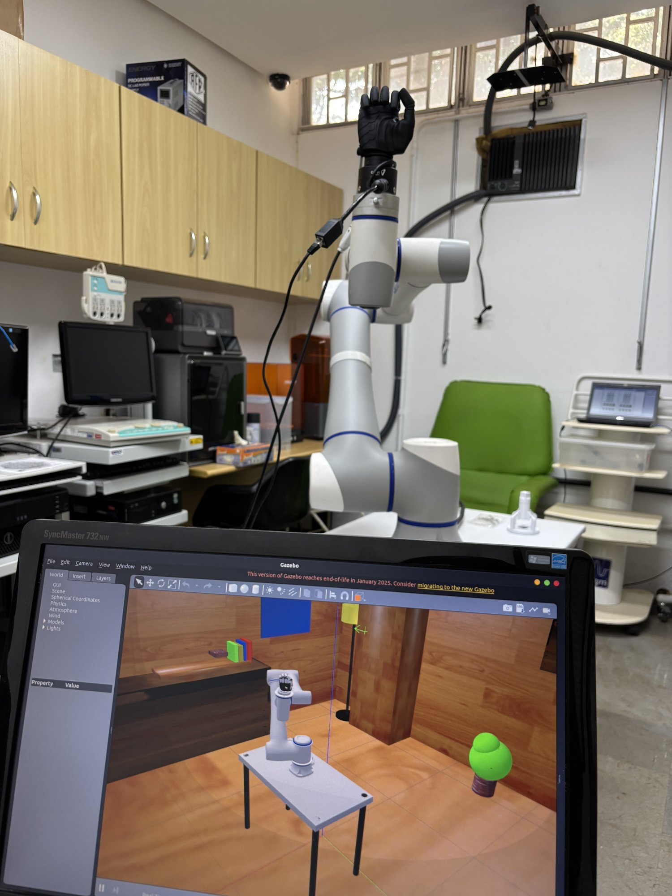
  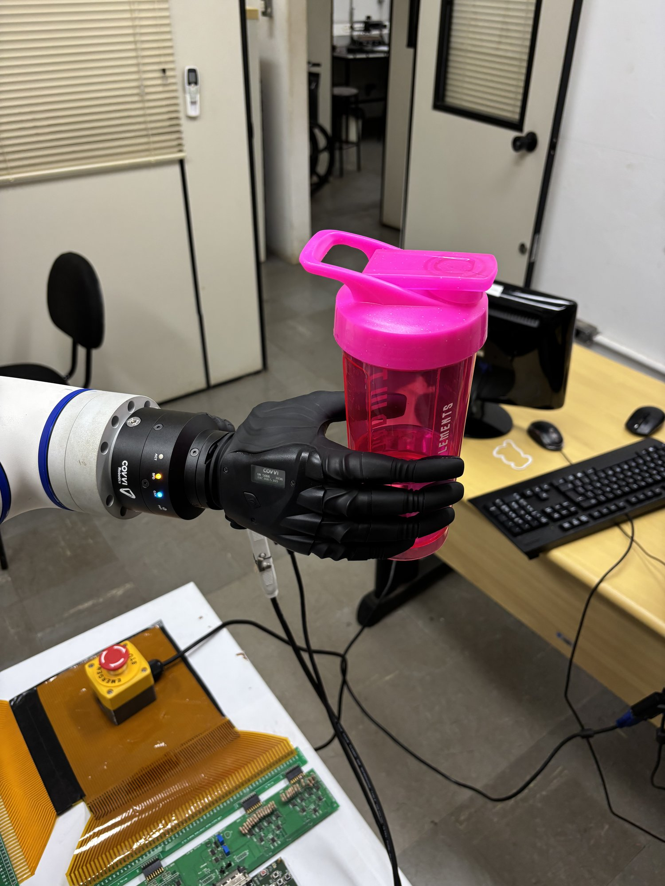
  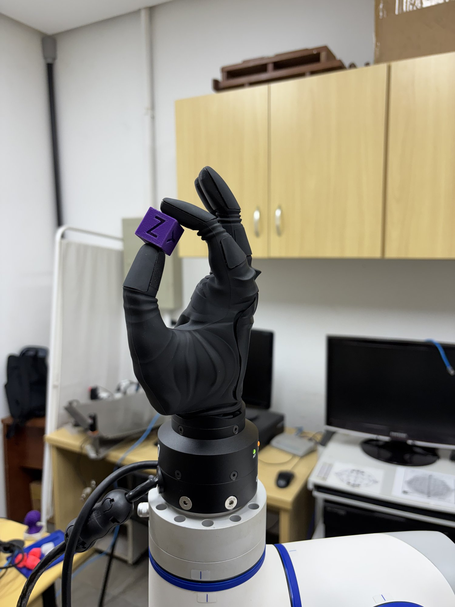
</p>
<p align="center"><em>The real hardware in the lab: the bench with the twin on screen · a <strong>power grasp</strong> on a bottle · a <strong>pinch grasp</strong> on a 3D-printed cube.</em></p>

<p align="center">
  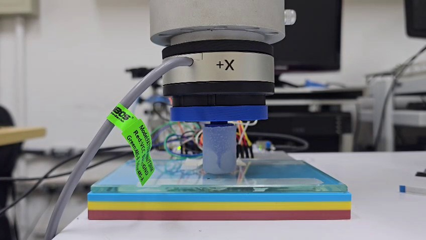
</p>
<p align="center"><em>The current palpation end effector: the <strong>FA7155 6-axis cell</strong> on the flange, the blue printed coupler and the contact tip on a sample. Swapping it for the COVVI hand is what <code>end_effector:=touch_tool</code> vs <code>hand</code> (the default) selects.</em></p>

---

## Installation

### Option A — Docker (reproducible, one command)

```bash
git clone --recursive https://github.com/Martins-Lucaas/cr10twin.git ~/cr10twin
cd ~/cr10twin
xhost +local:docker                       # once per session, for the GUI
docker compose run --build cr10twin       # shell in a built workspace
```

The image (`Dockerfile`) pins ROS 2 Humble + every dependency and runs
`colcon build`; `docker-compose.yml` bind-mounts your checkout so you edit on the
host and re-run `colcon build` inside. Uncomment the `devices:` block for the
real load cell / touch sensor. This is the same environment CI builds on every
push.

### Option B — native

```bash
# 1. Clone WITH the eci_ros submodule (COVVI hand driver)
git clone --recursive https://github.com/Martins-Lucaas/cr10twin.git ~/cr10twin
cd ~/cr10twin
#    Already cloned without --recursive?  git submodule update --init --recursive

# 2. Dependencies
rosdep install --from-paths src --ignore-src -r -y      # apt + system deps
pip install "numpy<2" pyserial matplotlib               # numpy<2 = cv_bridge ABI
#    Optional extras (YOLO / model training / mesh regen): see "Full dependency list".

# 3. Build and source
colcon build --symlink-install
source install/setup.bash
```

`cra_description` (the CR10 URDF) is already versioned in the repository; `eci_ros`
arrives through the submodule. Nothing beyond step 1 needs to be cloned.

> **Updating the submodule later:** `git submodule update --remote src/eci_ros`
> **`symbolic link ... Is a directory` error during the build:** `rm -rf build install && colcon build --symlink-install`
> **Always run `source install/setup.bash`** in every new terminal before any `ros2 launch`/`ros2 run`.

---

## Full dependency list

> `rosdep install --from-paths src --ignore-src -r -y` now resolves the build and
> runtime dependencies — the `package.xml` files were completed (numpy, matplotlib,
> pyserial, tk, xacro, `ament_index_python`, `covvi_interfaces`, and for `hand_pack`
> also `rclpy` / `sensor_msgs` / `trajectory_msgs`). Two deliberate exceptions
> remain: **`hand_pack` is not declared** as a dependency of
> `touch_pack`/`grasp_ml_pack` (their launch files import `hand_pack.urdf_helpers`,
> but `hand_pack` already depends on both — colcon would reject the cycle), and
> the **optional** `scikit-learn` / `torch` / `ultralytics` (YOLO + model training)
> and `cadquery-ocp` (TCP mesh regen) stay `pip`-only, listed below.

### Operating system

| Dependency | Version |
|---|---|
| Ubuntu | 22.04 LTS |
| ROS 2 | Humble Hawksbill — install **`ros-humble-desktop`**, which brings `rviz2` and `rqt_joint_trajectory_controller` (both declared by `hand_pack`) |
| Gazebo | Classic 11 |
| Python | 3.10+ |

### apt packages

```bash
sudo apt update && sudo apt install -y \
  ros-humble-gazebo-ros-pkgs \
  ros-humble-ros2-control \
  ros-humble-ros2-controllers \
  ros-humble-gazebo-ros2-control \
  ros-humble-xacro \
  ros-humble-joint-state-publisher-gui \
  ros-humble-vision-msgs \
  ros-humble-cv-bridge \
  ros-humble-control-msgs \
  ros-humble-admittance-controller \
  ros-humble-kinematics-interface-kdl \
  ros-humble-force-torque-sensor-broadcaster \
  python3-tk \
  python3-pil \
  python3-pytest \
  python3-colcon-common-extensions \
  git
```

### Python

```bash
# numpy<2 is mandatory — Humble's cv_bridge is compiled against NumPy 1.x
pip install "numpy<2" opencv-python

# touch_pack — load-cell serial port and the Sensors-tab plots
pip install pyserial matplotlib

# COVVI hand driver — proprietary ECI library from COVVI Robotics
pip install covvi-eci==1.1.6

# Optional — YOLOv8 detector (only grasp_ml_pack with use_yolo:=true)
pip install ultralytics

# Optional — train the GraspQualityNet (src/grasp_ml_pack/scripts/train_grasp_model.py).
# scikit-learn drives the 'rf' backend, torch the 'nn' one. models/ ships empty,
# so anyone who wants the model has to train it.
pip install scikit-learn torch

# Optional — regenerate the palpation TCP meshes/inertias from cad/step/*.step
pip install cadquery-ocp
```

> **Optional, apt:** `python3-vtk9` enables the GPU backend of the **3D Manipulation** tab
> (the exact URDF mesh, offscreen). Without it the tab falls back to the decimated CPU
> renderer — nothing breaks.

### External dependencies — already handled by the repository

| Package | Origin | How it gets in |
|---|---|---|
| `cra_description` | extracted from [`Dobot-Arm/DOBOT_6Axis_ROS2_V4`](https://github.com/Dobot-Arm/DOBOT_6Axis_ROS2_V4) | **already versioned** under `src/cra_description` — nothing to clone |
| `covvi_interfaces` + `covvi_hand_driver` (`src/eci_ros`) | **git submodule** | cloned automatically with `git clone --recursive` (see Installation) |

> **Credits — COVVI hand driver:** `src/eci_ros` is authored by **COVVI Robotics** ([`COVVI-Robotics/eci_ros`](https://github.com/COVVI-Robotics/eci_ros)), released by them under Apache-2.0 and maintained upstream by Jordan Birdsall. It is included as a submodule pointing to a fork ([`Martins-Lucaas/eci_ros`](https://github.com/Martins-Lucaas/eci_ros)) that **fully preserves the original authorship, licence and maintainer**. The fork carries two downstream changes only: closing the ECI session on shutdown, and declaring the `rclpy` / `covvi_interfaces` runtime dependencies that the original `package.xml` omitted.

> **Note:** even in simulation-only mode, `covvi_interfaces` must be built — several nodes lazily import those types to command the real hand when it is enabled.

---

## Package guide

Each package documents how to run it in its own README.

<p align="center">
  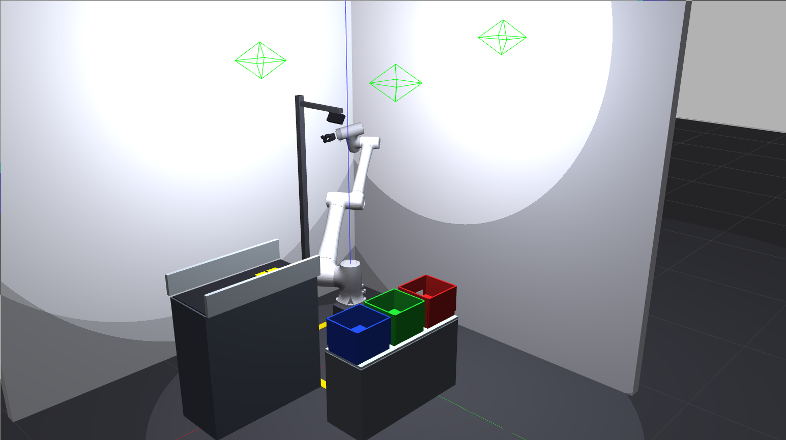
  
  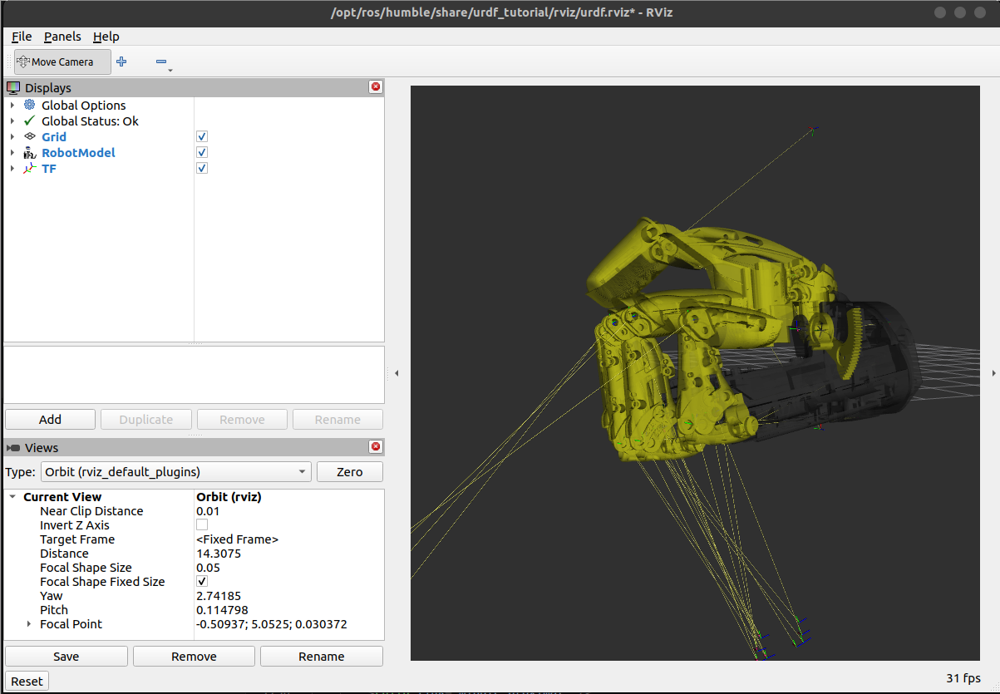
</p>
<p align="center"><em><code>grasp_ml_pack</code> — manufacturing cell · <code>touch_pack</code> — tactile palpation cell · <code>hand_pack</code> — combined CR10 + COVVI URDF.</em></p>

| Package | Main role | README |
|---|---|---|
| **`grasp_ml_pack`** | Manufacturing cell: conveyor, object detection, pick-and-place with COVVI | [→ grasp_ml_pack/README.md](src/grasp_ml_pack/README.md) |
| **`hand_pack`** | Combined CR10 + COVVI URDF, hand GUIs, launch helpers | [→ hand_pack/README.md](src/hand_pack/README.md) |
| **`touch_pack`** | Tactile palpation cell: Gupta 2021 protocol (Touch · Slide · Manual · Matrix map), GUI with 3D manipulation, logging, FA7155 6-axis load cell + STM32 touch sensor (Izhikevich) | [→ touch_pack/README.md](src/touch_pack/README.md) |
| **`touch_pack_msgs`** | Message package for the palpation cell: `PalpationStart`, `PalpationStatus`, `MatrixPoint`, `SyncedTouch` | — |
| **`cra_description`** | URDF/Xacro of the Dobot CR10 arm (extracted from the official Dobot repository) | [→ cra_description/README.md](src/cra_description/README.md) |

### Palpation cell — what it can do today

| Capability | Where |
|---|---|
| **Touch** mode — press to a force setpoint and return, N times | `tactile_explorer` |
| **Slide** mode — full Gupta cycle with a lateral drag along ±X/±Y | `tactile_explorer` |
| **Manual** mode — infinite HOLD with the setpoint editable live (`/palpation/set_force`) | `tactile_explorer` |
| **Matrix map** — indents a grid of points at one setpoint; the robot discovers the plane origin itself and logs one row per indentation (`__matrix.csv`) | `tactile_explorer` |
| **Modulated force** — the HOLD setpoint follows `F(t) = mean + amp·sin(2πf·t)` (position feedforward, `Δx = ΔF/K`) | `force_mod_*` params |
| **3D Manipulation tab** — drag the TCP with the mouse, differential IK at 33 Hz, rendering the *same* URDF Gazebo got (VTK GPU / PIL CPU / skeleton fallback) | `manip3d`, `urdf_scene`, `vtk_render` |
| **Real MovJ/RelMovL execution** — palpation run by the real controller instead of ServoJ streaming (`real_movl:=true`, the default) | `real_driver` |
| **Mirroring latency measurement** — cross-correlates the simulated and physical joint series | `latency_probe` |
| **Run analysis** — aggregates `sensors/Data/*__summary.json` and classifies each run (`BOM`/`STALL`/`QUIQUE`/`MARGINAL`) | `scripts/analyze_force_runs.py` |
| **TCP calibration** — 4-point pivot, least-squares, pushed to the controller as `Tool(1)` | `tcp_calib` (Manual Control tab) |
| **Camera hand control** — MediaPipe tracks your hand and drives the COVVI sliders (sim, and the real hand with ECI ON) | `hand_camera_teleop` (`CAM` button) |
| **IMU tab** — in `hand` mode the first tab shows the WBAN IMUs, with AG/MAG calibration and recording | `gui_imu`, `imu_node`, `imu_recorder` |
| **Hand latency measurement** — same cross-correlation, on the COVVI joints | `hand_latency_probe` |

<p align="center">
  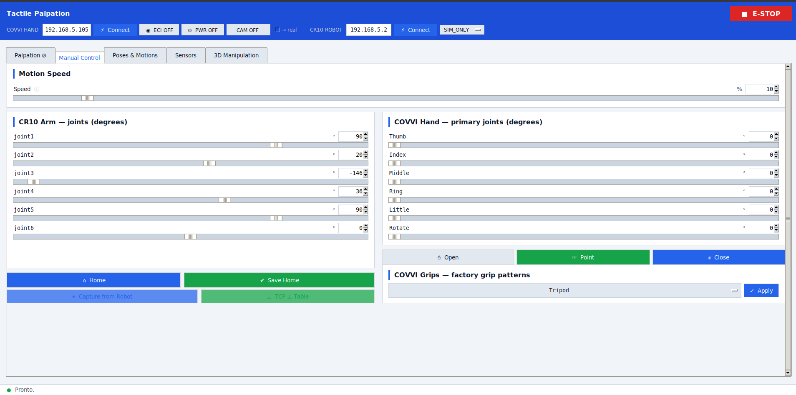
  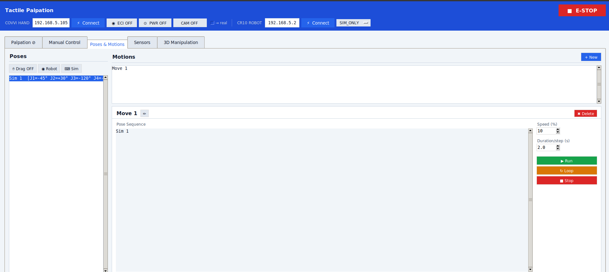
  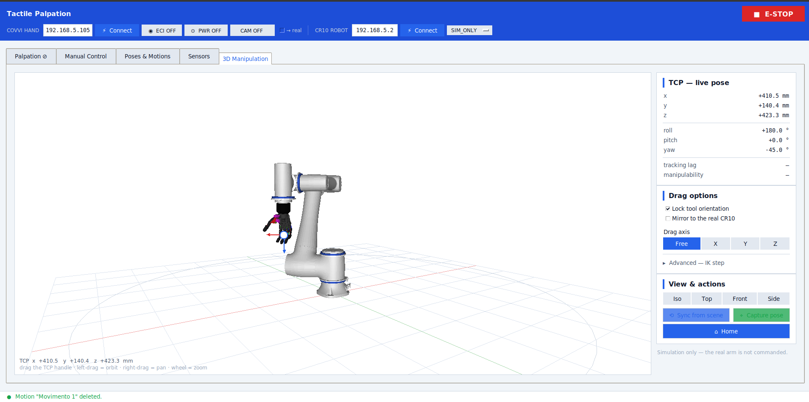
</p>
<p align="center"><em>The <code>palpation_gui</code> today (hand mode): <strong>Manual Control</strong> · <strong>Poses &amp; Motions</strong> · <strong>3D Manipulation</strong>.</em></p>

---

## Repository layout

```
cr10twin/
├── src/                  ROS 2 workspace (packages in the table above)
├── cad/
│   ├── step/             STEP sources of the palpation TCP — FA7155 stack, couplers and
│   │                     the tips A–F. The touch_pack meshes and inertias are
│   │                     regenerated from here.
│   └── SENSOR TÁTIL 5X5/ CAD of the 5×5 tactile sensor
├── sensors/
│   ├── touch_5x5/        5×5 tactile sensor: firmware/ (STM32, host-tested Makefile), cbeb/
│   │                     (CubeIDE project), variants/ (other firmwares) and tools/ (plotters,
│   │                     collection and processing scripts)
│   ├── touch_4x4/        4×4 tactile sensor: firmware/ (RA+SA+CN) and tools/ (plotter)
│   ├── touch_dual/       Firmware + interface for both sensors on one STM32 (not used by the GUI)
│   └── Data/             Palpation runs — created at runtime by `palpation_logger`,
│                         not versioned. Layout and file formats in touch_pack/README.md
├── data/                 Versioned measurements behind the paper: latency/ and latency_hand/
│                         (written there directly by the latency probes) and IMU data/
├── tools/imu_arm_teleop/ Standalone bridge (not a ROS node): WBAN IMUs → CR10 Cartesian teleop
├── docs/adr/             Design decisions the code does not make obvious — read before
│                         touching force control, the load cell or firmware
├── images/               Photos, Gazebo/GUI screenshots, diagrams, videos and their posters
├── Docs/                 Vendor manuals (Dobot, COVVI, FA7155) — local only, not versioned
├── Dockerfile · docker-compose.yml   Reproducible ROS 2 Humble environment (also used by CI)
└── modbus.txt            Dobot Appendix A — Modbus register map (robot as Modbus slave)
```

---

## Connecting the real hardware (optional)

- **COVVI hand:** from the GUI (`touch_pack`/`grasp_ml_pack`), enter the IP and click **Connect** → **ECI ON** → **PWR ON**. Internally this starts `ros2 run covvi_hand_driver server <IP>`.
- **CR10:** set `robot_ip` and use `control_mode:=mirror` (mirrors the real arm in sim) or `real_from_sim`. For *drag teach*, put the controller in **REMOTE mode** on the teach pendant.
- **Load cell (FA7155):** RS485 → USB through the CH343 converter, no firmware of ours. `ft_receiver` is the sole owner of the port and auto-detects it by the WCH VID `0x1A86`; it publishes `/ft_sensor/wrench` plus the `/load_cell/*` contract the modulation loop consumes.
- **IMUs (WBAN-Inercial):** with `end_effector:=hand`, `imu:=true` (default) starts `imu_node`; set `imu_iface` to the local IP of the interface the ESPs are on and `wban_dir` to the KINESIS checkout it imports.
- **Touch sensor (STM32):** connects over USB (115200 baud) — the GUI reads the serial port directly in the **Sensors** tab. Pick the array with `sensor:=4` (4×4, sends `I_final`) or `sensor:=5` (5×5, no TOTAL line). Flash the firmware from `sensors/touch_5x5/` or `sensors/touch_4x4/` to match. Without a local serial port, run a plotter from that sensor's `tools/` and relay over UDP: port **8081** for the scalar (`touch_receiver`) and **8082** for the raw frame.

---

## License

<div align="center">

**Apache-2.0**

Developed by **Lucas Martins** · [lucaspmartins14@gmail.com](mailto:lucaspmartins14@gmail.com)

TCC — Biomedical Engineering

</div>
